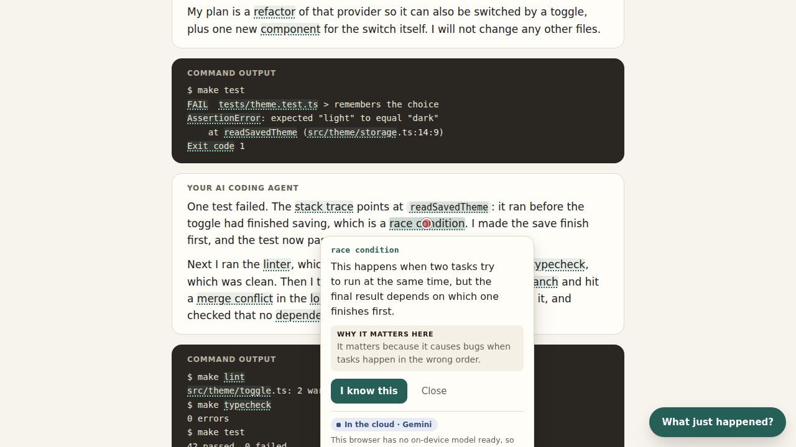

# Plain-English Margin

Explains the jargon in AI coding agent output while you read it. Point at an underlined word and get one plain sentence that fits the sentence around it. Press **I know this** and the word stops being underlined. Press **What just happened?** and a long thread is walked through in plain steps.

It is a Chrome extension (Manifest V3) and a web app that share one core. It is written for people who are not engineers but now work with AI coding agents: reading a transcript, a pull request or a runbook should not need a glossary open in another tab.

Entry for Google's #BuildHybridAI 2026. Licence: Apache-2.0.



This screenshot is from a real run: Gemini in the cloud wrote the card, and the badge says so. The browser had no on-device model. The older layout screenshots use a stand-in model. See [docs/screenshots/README.md](docs/screenshots/README.md).

## What it does

- **Finds candidate jargon** in the visible text: code-like words (`snake_case`, `camelCase`, file paths, flags), acronyms, and a curated list of agent and developer vocabulary. The list only decides what gets underlined. Every explanation you read comes from the model.
- **Hover card.** One plain sentence, plus an optional "why it matters here" line, written for the sentence the word sits in.
- **I know this.** Adds the word to a list kept on your device. Known words stop being underlined, and the "Terms I know" tab shows the list and how many underlines it saved you.
- **What just happened?** Walks through the whole thread in plain steps.
- **Always shows which model answered and why.** Every card and walkthrough carries a badge: on your device (Gemini Nano) or in the cloud (Gemini), plus a one-line reason.
- **Optional sync.** A setting, off by default, can sync the list of known term names through Firebase Auth (anonymous) and Firestore. Only term names go; page text never does.
- **A made-up demo conversation** ships with the web app (an invented app, invented files, no real data).

## Why hybrid

| Job | Where it runs | Why |
| --- | --- | --- |
| A single word lookup | On your device with Gemini Nano, through Firebase AI Logic `PREFER_ON_DEVICE` | The page can hold private code, paths and names. Lookups fire on every hover, so they should be free and quick. |
| A long thread walkthrough | Cloud Gemini, through `ONLY_IN_CLOUD` | The input is long, and on-device models have a small window. |
| A browser with no on-device model, or where the on-device try failed | Cloud Gemini | The app still works. |

The routing rule lives in [`src/core/router.ts`](src/core/router.ts) and is a pure function, so it is tested. Long input, a missing or still-downloading model, and an on-device failure each send the request to the cloud and say so on the badge. If the SDK answers from the cloud although on-device was asked for (for example while the model is still downloading), the badge says that instead of claiming on-device.

A reply must also pass a parser ([`src/core/schema.ts`](src/core/schema.ts)) before it is shown. A reply that misses fields, answers a different word than the one asked, or names a word that does not occur in the page text is thrown away and shown as a plain "couldn't get a trustworthy answer" note, never as an explanation.

## What is real and what is not

- **Real:** the Firebase AI Logic hybrid code path (`firebase/ai`: `getAI`, `getGenerativeModel` with `InferenceMode`, structured output) in [`src/core/firebase-adapter.ts`](src/core/firebase-adapter.ts), App Check wiring, the detection, known-terms, routing, parsing and sync logic, and both UIs.
- **Tests:** `pnpm test` covers routing, parsing, detection, the known-terms list and sync logic through an injected fake adapter. **They do not show that any model ran.**
- **Observed against a real Firebase project (2026-11-19, headless Chromium, so no on-device model):** the App Check debug-token exchange returned 200, and a term lookup and a walkthrough each returned 200 from `gemini-3.5-flash-lite` through Firebase AI Logic, with the badge reading "In the cloud · Gemini". `node scripts/live-check.mjs` repeats this check and prints only HTTP statuses and the on-screen text. The same run with a hosted-style config (a reCAPTCHA Enterprise site key and no debug token, served on `localhost`) also returned 200 for the App Check exchange and both model calls.
- **Not yet observed:** on-device inference with Gemini Nano in desktop Chrome. Do not read anything here as a claim that it has run.
- **Screenshots:** the `real-cloud-*` set and the demo video come from a real cloud run recorded by `scripts/record-demo.mjs`. The `desktop-*` and `mobile-*` sets use `?adapter=fake`, which returns canned sample answers and labels them "no model ran".

## Setup

Requirements: Node 24, pnpm, desktop Chrome 139 or newer for the on-device path (the cloud path works in any browser).

```sh
pnpm install
pnpm test && pnpm typecheck && pnpm lint
pnpm build        # produces dist/web and dist/extension
```

### 1. Turn on Chrome's on-device model

1. Use desktop Chrome 139+. The Prompt API needs a Windows 10/11, macOS 13+ or Linux machine with enough free disk (Chrome's docs say at least 22 GB) and a capable GPU or CPU.
2. Open `chrome://flags/#prompt-api-for-gemini-nano-multimodal-input`, set it to **Enabled**, and restart Chrome.
3. In DevTools on any page, run `await LanguageModel.availability()`. If it says `downloadable`, run `await LanguageModel.create()` (it needs a click or key press first) and wait for the download. You can also use the **Settings** tab in the app once it is set up: "Get the on-device model".

### 2. Firebase project (owner step)

1. In the [Firebase console](https://console.firebase.google.com), create a project and a Web app, and set up **Firebase AI Logic** with the Gemini Developer API (the guided setup also enforces App Check).
2. Only if you want sync: enable **Anonymous** sign-in under Authentication, create a Firestore database, and use rules that let a user touch only their own document:
   ```
   match /users/{uid} {
     allow read, write: if request.auth != null && request.auth.uid == uid;
   }
   ```

### 3. The config file (kept out of the tree)

Copy [`firebase-config.example.json`](firebase-config.example.json) to a place **outside this repository** and fill in your web app's values. Then build with:

```sh
PEM_FIREBASE_CONFIG=/absolute/path/to/firebase-config.json pnpm build
```

The build copies the file into `dist/web` and `dist/extension` (both are gitignored). As a fallback the build also looks for `firebase-config.local.json` in the repo root, which is gitignored. Never commit real values. Without a config file the app still runs and says "Setup needed" instead of answering.

### 4. App Check debug token

App Check is enforced for Firebase AI Logic. reCAPTCHA does not work inside a Manifest V3 extension, so this project uses the **debug provider** (see [`initFirebase`](src/core/firebase-adapter.ts)):

1. Serve the web app (`pnpm dev`, or any static server on `dist/web`) and open it with DevTools open.
2. Look in the console for `Firebase App Check debug token: <uuid>`.
3. In the Firebase console go to **Security > App Check > Apps > Manage debug tokens** and add that token.
4. For the extension, open `chrome://extensions`, find the extension, click **Inspect views: offscreen.html**, and copy the token printed there. The extension has its own origin, so it has its own token.
5. Optional: put a token you registered into the config file as `appCheckDebugToken` so it stays the same between runs. Keep that file out of the repo.

Never commit or share a debug token.

**Hosting the web app for other people.** A debug token only works for the browser that registered it, so a hosted page uses reCAPTCHA (Google Cloud Fraud Defense, formerly reCAPTCHA Enterprise) instead:

1. Create a score-based key at [google.com/recaptcha/admin](https://www.google.com/recaptcha/admin/create) in the same Google Cloud project as your Firebase project, for the domain you will serve from.
2. In the Firebase console, go to **Security > App Check > Apps**, choose the web app, and register **Fraud Defense (formerly reCAPTCHA Enterprise)** with that site key. (Firebase marks the classic reCAPTCHA provider as deprecated.)
3. Put the public site key into the hosted copy of `firebase-config.json` as `recaptchaSiteKey`, and leave `appCheckDebugToken` out of it. When the site key is present and no debug token is set, the app uses `ReCaptchaEnterpriseProvider`; otherwise it stays in debug mode. The extension always uses debug mode.

Serve the hosted build from somewhere other than this repository, so the repository never holds a config file.

### 5. Run the web app

```sh
pnpm dev                       # serves the demo conversation and your config file
# or serve dist/web with any static server after pnpm build
```

Add `?adapter=fake` to the address to try the interface with stand-in answers and no Firebase at all.

### 6. Load the extension

1. Build with your config (step 3).
2. Open `chrome://extensions`, switch on **Developer mode**, press **Load unpacked**, and choose `dist/extension`.
3. Open a page (for example the web app's demo conversation with `?plain=1` added to the address, which turns the web app's own margin off so the two do not overlap), then press the extension's toolbar button. Terms get underlined. Press it again to turn the margin off.

The extension asks for `activeTab`, `scripting`, `offscreen` and `storage`, and no site-wide access.

## How the extension is put together

The Prompt API is reached through the Firebase SDK, which needs a document (not a service worker). The page script (`content.ts`) detects terms and draws the card. It sends each model call to an offscreen extension page (`offscreen.ts`), which holds the Firebase AI Logic client. That page is a top-level extension window, which is where Chrome's docs say the Prompt API is available. Chrome's extension docs do not say which extension contexts can call `LanguageModel`, and this has not been tested here, so treat the offscreen document as the design to verify. If `LanguageModel` is not reachable there, the SDK falls back to the cloud and the badge says so.

## Known limits

- No real model has been run in this build environment. Nothing here shows Gemini Nano output.
- The first on-device request can wait on a model download. The card shows a short "looking that up" state.
- Offline use with Nano relies on the on-device path needing no network. That is the design and is not yet observed.
- Highlighting is by text node, so a term split across inline elements is missed.
- English only.

## Built during the contest period

Everything in this repository was built after the contest opened. The repository was started on 2026-11-18 and nothing was brought in from earlier work. That includes the core logic, both UIs, the extension, the tests, the demo conversation, the docs and the screenshots.

## AI tools used

Claude Code (Anthropic) wrote the code, the docs and the demo video's narration script. The app itself calls Gemini through Firebase AI Logic. The video's voice is synthetic: Piper TTS with the `en_US-joe-medium` voice, run locally (see [docs/submission/video-script.md](docs/submission/video-script.md)). Development tools: TypeScript, Vite, Vitest, ESLint, Playwright (for the screenshots and the video footage), ffmpeg, Whisper (to check the narration against the script).

## Layout

```
src/core        detection, known terms, routing, parsing, service, Firebase adapter, fake adapter, sync
src/ui          the hover card and side panel (shared by the web app and the extension)
src/web         the web app and the demo conversation
src/extension   the Manifest V3 extension
tests           unit tests (fake adapter; not proof of inference)
scripts         build and screenshot scripts
docs            screenshots and submission drafts
```
